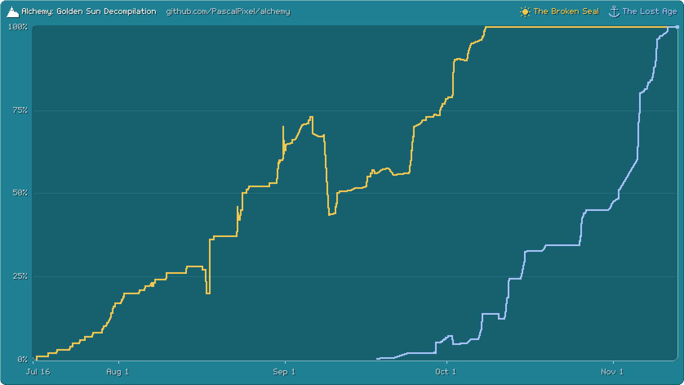

# 🌋 Alchemy Devtools

Optional Rust tools for matching a GBA game's machine code as C, made for [Alchemy](https://github.com/PascalPixel/alchemy)'s decompilation of Golden Sun and The Lost Age: measure a C draft against the game's code, rank what is left, adopt what matches into the build in every edition, check the build against the reference ROMs, count what is done, and render the game for the documentation. Building or modding the games doesn't need them.

The code that knows nothing of Alchemy (reading ELF files and GNU ld maps, a function's bounds, a source's compile commands from its own Makefile, pret's calcrom count, the Thumb reader, the shapes that find a function's twin) lives in `src/gba/` and is written to serve any GBA decompilation; Alchemy's layout, editions and overlays live in `src/alchemy/`.

## Install

Install [Rust](https://rustup.rs), then clone this repository into the `alchemy-devtools/` folder of an Alchemy checkout, which Alchemy's git ignores, and build it there:

```sh
cd alchemy
git clone https://github.com/PascalPixel/alchemy-devtools
cd alchemy-devtools
cargo build --release
target/release/alchemy-devtools --help
```

Run from inside the Alchemy checkout, the commands find it themselves. From a checkout of its own anywhere else, set `ALCHEMY_ROOT` to the Alchemy checkout the commands should read. [AGENTS.md](AGENTS.md) holds the method and the rules for decompilation work on Alchemy.

`render` and `lit` need the `render` feature, which runs the game in libmgba and reads and writes PNG. Install mGBA's library and headers (Homebrew's `mgba`), or name their prefix with `MGBA_PREFIX`, then:

```sh
cargo build --release --features render
```

## Commands

| Command | What it does |
|---|---|
| `adopt` | gathers a game's objects into one (`adopt merge`), editing its linker script, with `--keep-views` keeping each disagreement between the sources as a marked view; `adopt settle` deletes the views that move no code; `--verify` has the build judge it, and a journal undoes the batch or one item of it |
| `check` | each built ROM, overlay and PACKER row against the reference ROMs, and the fake-match tags against the project's rule |
| `diff` | a C draft compiled as the build compiles it, against the listing it would replace |
| `editions` | the objects from `games/` some edition does not link, with the names each defines |
| `lit` | recolours a picture in alchemy-lit, the colour correction the docs site's filter is fitted to (feature `render`) |
| `passdiff` | why a form is kept: an object compiled as it stands and with a plain variant, its RTL compared pass by pass |
| `permute` | searches rewrites of a draft toward differ 0 |
| `progress` | DONE code and data from the linker maps, and what is left to humanize (`--humanity`) |
| `rank` | every unfinished piece of a game, furthest first, each with the command that measures it |
| `regress` | the functions whose assembly differs from a saved build, each classed |
| `render` | the docs site's pictures and recordings, and the probes the source cites (feature `render`) |
| `sweep` | takes out the fake-match devices every edition compiles the same without |
| `twins` | for each unfinished function (with `--all`, each matched one), the other game's matched function most like it |
| `variants` | named rewrites of a draft, measured, best first |
| `where` | the bytes each edition still places from `recon/` (none, once it is gone), and DONE from the maps |

Run any command with `--help` for its options.

## Progress

Both games reached 100%: every byte of all twelve editions, The Broken Seal's six and The Lost Age's six, builds from Alchemy's source. This chart, drawn from each landing's measurement, is the record of how they got there. It is no longer updated.



## Test

```sh
ALCHEMY_ROOT=/path/to/alchemy cargo test --locked --workspace
ALCHEMY_ROOT=/path/to/alchemy cargo test --locked --workspace --features render
```

The tests read a bootstrapped Alchemy checkout with every edition built.

## Credits

- [Simon Lindholm](https://github.com/simonlindholm/decomp-permuter): decomp-permuter, whose search `permute` reimplements.
- [pret](https://github.com/pret): calcrom, the count `progress` follows.
- [objdiff](https://github.com/encounter/objdiff): the report format `progress` wrote for decomp.dev while the games were being matched.

Alchemy's [acknowledgements](https://github.com/PascalPixel/alchemy#acknowledgements) have the rest.
